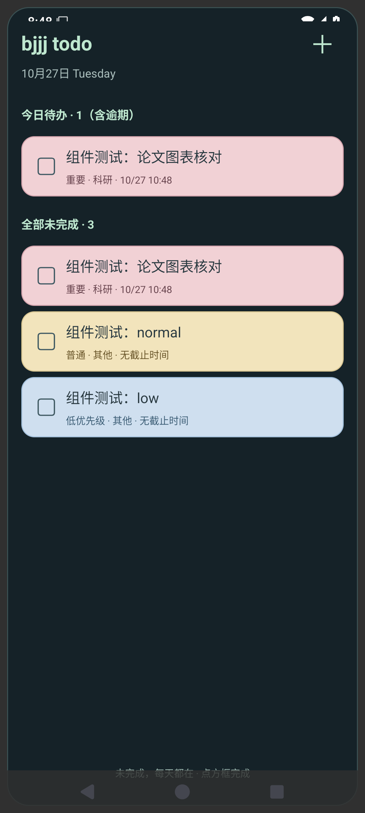

<h1 align="center">不急及及待办 · bjjj todo</h1>

<p align="center"><b>给待办，留一整页手机桌面。</b><br>滑到这一页，看看今天要做什么，还有哪些事没完成。</p>
<p align="center">Android 可拉伸桌面小组件 · Windows 置顶浮窗 · 未完成跨天保留 · 本地使用无需账号 · MIT 开源</p>

<p align="center"><a href="https://github.com/bjjjzmzbjf/bjjj-todo/releases/latest/download/bjjj.todo.android.apk"><b>↓ 下载安卓安装包</b></a>　·　<a href="https://github.com/bjjjzmzbjf/bjjj-todo/releases/latest/download/bjjj.todo.exe"><b>↓ 下载 Windows 免安装版</b></a>　·　<a href="#从记录到完成">看功能与截图</a>　·　<a href="#三步开始使用">开始使用</a></p>

论文要修改，组会要准备，生活里还有几件小事。把它们放在手机的一页桌面上：解锁后滑过去就能查看，做完直接勾选。换到电脑，打开一个置顶浮窗，把今天的安排留在屏幕一角。

**bjjj todo 是一款面向 Windows 与 Android 的开源待办软件，围绕“让没做完的事持续可见”设计。** 你可以查看某一天的安排，也可以随时看到全部未完成事项；昨天没勾掉的，今天还在，不必每天重新抄一遍。

## 一页手机桌面，专门放你的待办

把“不急及及待办”小组件拖到一张空白桌面，再拉伸边框，让这一页成为自己的待办页。打开手机，滑到这一页，就能查看和勾选事项，无需先进入 App 列表页面。

<table>
  <tr>
    <td width="45%" align="center"></td>
    <td width="55%">
      <p><b>今天该做的，和还没做完的，一起看。</b></p>
      <p>上方是今日及逾期待办，下方是全部未完成。事项多时可以滚动查看，超过一页可翻页。</p>
      <p><b>在桌面直接完成。</b></p>
      <p>点方框勾选，组件与 App 共用本机数据；想新增事项，点右上角的＋。</p>
      <p><b>大小、透明度，按你的桌面调整。</b></p>
      <p>组件支持横向、纵向拉伸，背景不透明度可设为0–100%。重要事项用浅红色，普通事项用浅黄色，低优先级用浅蓝色。</p>
    </td>
  </tr>
</table>

<sub>上图为原生小组件在测试容器中的展示，使用示例事项。添加到真实手机桌面后，壁纸、可用空间及固定边距由手机启动器决定；可拉伸到一页桌面的可用区域，不能覆盖状态栏、导航栏或系统保留区域。组件较小时会省略今日区。</sub>

**添加只需三步：** 长按手机桌面空白处 → 在“小组件／小部件”中找到“不急及及待办”并拖入 → 长按组件，拉伸到合适大小。App 内也提供添加请求和手动教程，部分手机需手动添加。

## 这张清单，把这些细节放在了一起

| 你在意的体验 | bjjj todo 的具体做法 |
| --- | --- |
| 昨天的事没做完，今天仍能看见 | “全部未完成”跨天持续保留，逾期也不自动消失；切换日历日期不会藏起这张清单 |
| 手机有一页待办，电脑也能随手看 | Android 用可拉伸桌面组件，Windows 用可独立置顶的浮窗；两边都能直接勾选 |
| 看日期，就知道哪天有重要的事 | 周日期条与手机月历按当天未完成事项的最高重要性着色，同时显示事项数量 |
| 一个截止时间，分几次提醒自己 | 同一事项可添加多个自定义提前提醒，支持天、小时、分钟、秒，以及到时提醒 |
| 先记下来，不急着注册或配置同步 | 两端均可不登录、本地使用；Windows 支持 JSON 导出备份，源码采用 MIT 许可 |

## 从记录，到完成

### 01　没做完的事，明天仍然看得见

主窗口把**当天安排**和**全部未完成**放在一起。选日期时查看当天要做的事，往下看时接着处理还没做完的事。逾期事项继续保留原截止时间，不会因为跨了一天而变成一条新任务。

完成后勾选；需要继续处理时，也能从完成记录中恢复。事项只分为科研、工作、学习、生活、其他五类，卡片上同时显示类型和重要性。

<p align="center"></p>

### 02　手机看周月，电脑看整月

今天先做什么，这个月哪几天有重要节点，都能在日期上找到位置。**手机提供周视图与月历总览**，点击日期查看当天未完成事项，也能从“这天新建”填入选中日期。

<p align="center">　</p>

**Windows 月历**还支持农历、节气、节日标签，以及类型、重要性和关键词筛选。点击日期展开完整列表，查看、勾选完成或新建该日事项；没有日期的想法也能单独查看。


主窗口、月历和浮窗共享本机数据，一处勾选，其他窗口一起更新。日历中的节日和节气是日期标签，不表示法定放假或调休安排。

### 03　论文修改时，把安排留在电脑一角

读文献、写文章、准备汇报时，可以打开独立浮窗，拖到方便查看的位置。浮窗支持调整大小、独立置顶和直接勾选，重启后恢复开关与位置。

<table>
  <tr>
    <td width="46%" align="center"></td>
    <td width="54%">
      <p><b>今日待办</b></p><p>显示今天截止的事项，以及之前逾期未完成的事项。</p>
      <p><b>最近三项</b></p><p>按截止时间显示接下来的三项，不重复今日区已有的事项；未设时间的事项排在最后。</p>
      <p><b>留在视线里</b></p><p>主窗口可以收起，浮窗继续留在桌面。关闭主窗口后，程序仍在托盘运行并检查提醒。</p>
    </td>
  </tr>
</table>

### 04　一个提交时间，提前几次提醒

例如“提交论文修改稿”，可以同时设置 **提前3天 → 提前1天 → 提前2小时 → 到时提醒**。每个节点都可自定义数值与单位，同一事项最多添加20个提醒；设置为0表示到时提醒。

<p align="center"></p>

支持天、小时、分钟和秒。**秒是设置精度，实际送达时间受系统调度、通知权限和省电策略影响。** Windows 需保持程序在运行；安卓需开启通知与准时提醒权限。关机、休眠或强制停止等情况可能影响提示，重新运行后会检查错过的节点。

### 05　待办页也能融入自己的桌面

Windows 可以选择本地图片作为背景，主窗口、月历和浮窗同步使用，并可调整遮罩深浅。Android 小组件可调整背景不透明度，按喜好透出桌面壁纸。

<p align="center"></p>

Windows 支持 PNG、JPEG、WebP，单张最大20 MB；背景图片复制到本机数据目录。截图中的事项与背景仅作展示，下载程序不附带这些数据。

## 本地先用起来，同步按需开启

**记录、提醒、周月查看和桌面组件等本机功能，不需要注册账号。** 两端分别保留本地事项；Windows 可导出和追加导入 JSON 备份，自动保留上一份保存的数据。安卓版暂不提供手动导入导出。

默认 Windows 数据目录为 `%APPDATA%\bjjj todo\`：`tasks.json` 保存事项与设置，`tasks.json.bak` 保存上一份数据，`background.jpg` 保存自定义背景。JSON 备份不含背景图片，重复导入可能产生重复事项。

**可选的电脑／手机账号同步目前处于个人测试阶段。** 同一账号可合并两端事项，离线修改联网后补同步，冲突时保留修改副本。当前内置服务的公开注册受限，不能作为面向所有人的即开即用同步服务；试用本地功能无需等待开通同步账号。账号创建、自建方式和后台同步时机见 [云同步指南](CLOUD_SYNC.md)。

<p align="center"></p>

## 适合把这些事情留在眼前

- **科研与论文**：论文修改、图表核对、组会准备放进“科研”，重要提交节点设置多次提前提醒。
- **学习与工作**：课程作业、阅读计划、会议和交付日期放进周月视图；做完直接勾选。
- **生活与临时想法**：购物、运动、出行准备先记下来，没有截止时间也能保留在全部未完成中。

## 三步开始使用

当前公开版本 **v1.2.0**，支持 Windows x64 与 Android 8.0及以上。

| 下载哪一个 | 文件与使用方式 |
| --- | --- |
| [Android 安卓安装包](https://github.com/bjjjzmzbjf/bjjj-todo/releases/latest/download/bjjj.todo.android.apk) | `bjjj.todo.android.apk`：安卓应用安装包。安装后打开一次，再添加桌面小组件；更新请直接覆盖安装，不要先卸载或清除数据 |
| [Windows 免安装程序](https://github.com/bjjjzmzbjf/bjjj-todo/releases/latest/download/bjjj.todo.exe) | `bjjj.todo.exe`：Windows免安装程序。放在固定目录双击运行；更新前先从托盘退出旧版，再替换文件 |

1. **下载并打开**：选择上方与你的设备对应的文件。GitHub 自动生成的 `Source code` 压缩包是源码，不是安装包。
2. **记下第一件事**：点“＋ 新建”，填写标题、类型和重要性；需要提醒时，设置截止时间并添加提醒节点。
3. **放到容易看见的位置**：手机添加小组件并拉伸；电脑开启桌面浮窗，按需要置顶。

Windows 首次运行会创建桌面快捷方式，也可在设置中补建。完整操作见 [使用指南](USAGE.md) 和 [安卓版使用指南](android/README.md)。

Windows 版尚无代码签名，下载页提供 `SHA256SUMS.txt`（下载文件的SHA-256校验值）。APK 使用项目固定签名，支持覆盖更新。已在 Windows 11 x64 与 Android 15 模拟器验证；手机启动器兼容情况仍欢迎反馈。目前没有 iOS、macOS、Linux 或 Windows ARM 专用版本。

## 常见问题

<details>
<summary><b>能真正铺满整页手机桌面吗？</b></summary>

组件支持横向、纵向拉伸，可在空白桌面页调整到启动器允许的大小。状态栏、底部图标栏、导航栏及固定边距由手机系统和启动器决定，无法保证每款手机都能无边距铺满。请先预留一张空白页，再长按组件调整大小。

</details>

<details>
<summary><b>昨天没做完的事，需要重新建一条吗？</b></summary>

不需要。“全部未完成”会持续保留原事项，逾期也不会自动消失；只需完成后勾选，或按实际安排修改截止时间。

</details>

<details>
<summary><b>关闭窗口后还会提醒吗？为什么没收到通知？</b></summary>

Windows 关闭主窗口默认收起到托盘，后台继续检查；从托盘选择“退出软件”才会彻底退出。彻底退出、关机或休眠期间无法弹出通知。请确认事项有截止时间及提醒节点，并检查系统通知、勿扰和省电设置。Android 还需检查通知与准时提醒权限，具体见安卓版指南。

</details>

<details>
<summary><b>能否与电脑／手机同步？</b></summary>

有可选的账号同步，目前内置服务用于个人测试、公开注册受限。两端均可先不登录，本地记录和使用桌面组件。需要同步时请先阅读 [云同步指南](CLOUD_SYNC.md)，确认账号开通与部署方式。手机后台拉取受系统调度限制，不承诺组件秒级刷新。

</details>

<details>
<summary><b>移动电脑程序后，桌面快捷方式失效怎么办？</b></summary>

从新位置打开程序，在设置中点“创建桌面快捷方式”。请将免安装程序保存在固定目录；只删除快捷方式不会删除待办数据。

</details>

## 开源与参与

项目采用 **MIT 许可**，可以使用、修改和分发，请保留版权与许可声明。如果“一页桌面放待办”也适合你，欢迎点一个 **Star ⭐**，方便以后找到项目和更新；也欢迎分享给需要的朋友。

遇到问题或有想法，欢迎提交 [Issue](https://github.com/bjjjzmzbjf/bjjj-todo/issues) 或 Pull Request。请附软件版本、手机品牌／Android版本或Windows版本，以及复现步骤；截图请隐藏个人事项。参与方式见 [贡献说明](CONTRIBUTING.md)。

<details>
<summary><b>本地开发与检查</b></summary>

使用 Node.js 24，在 Windows 中运行：

```sh
git clone https://github.com/bjjjzmzbjf/bjjj-todo.git
cd bjjj-todo
npm ci
npm start
```

`npm test` 执行核心逻辑检查；`npm run build` 生成 Windows 免安装程序，输出在 `release/`。安卓构建要求见 [安卓版使用指南](android/README.md)。

打包后的界面检查：

```sh
npx electron-builder --win --x64 --dir
node overview-smoke.cjs
node names-smoke.cjs
node shortcut-smoke.cjs
npm run test:ui-sync
npm run test:ui-account
npm run test:ui-mobile
```

生成下载校验文件：`node scripts/release-checksum.cjs`。Windows 的 JSON 导入会追加事项，不覆盖原清单，操作前建议先导出备份。

</details>

日期面板使用 [Air Datepicker](https://github.com/t1m0n/air-datepicker)，农历标签使用 [lunar-javascript](https://github.com/6tail/lunar-javascript)；Electron / Chromium 运行时的许可随程序分发。详见 [MIT许可](LICENSE) 和 [第三方许可](THIRD-PARTY-NOTICES.txt)。

<p align="center"><b>把事情，慢慢完成。</b><br><sub>不急及及待办 · bjjj todo</sub></p>
