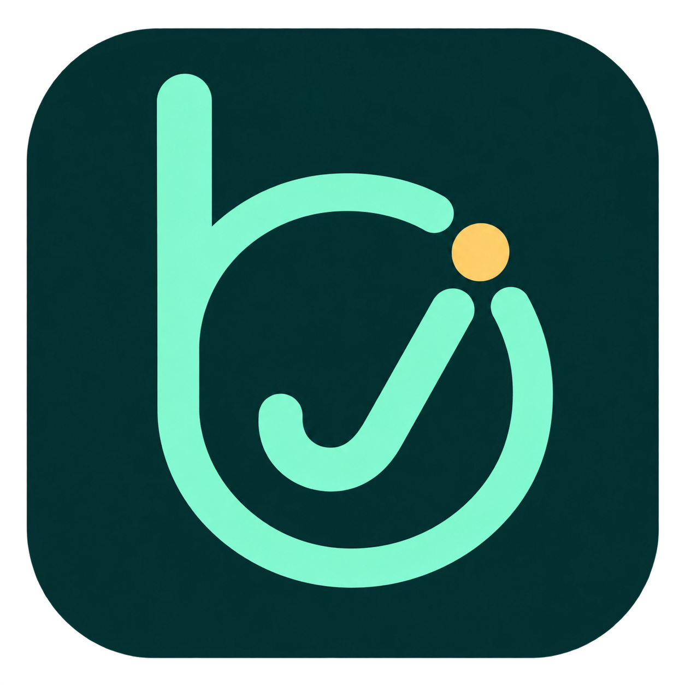

<p align="center"></p>

<h1 align="center">不急及及代办 · bjjj todo</h1>

<p align="center">把事情，慢慢完成。</p>

一个注重日常使用的 Windows 桌面待办软件。未完成事项跨天保留，支持自定义提前提醒、月历总览和桌面浮窗。

**当前版本：1.0.0（首版） · Windows x64 · 本地保存 · MIT 开源**

[下载 Windows 版](https://github.com/bjjjzmzbjf/bjjj-todo/releases/latest) · [反馈问题](https://github.com/bjjjzmzbjf/bjjj-todo/issues)

如果它让你的日常安排更轻松，欢迎在右上角点一个 **Star ⭐**，也欢迎分享给需要的朋友。

## 下载使用

进入 [软件下载页面](https://github.com/bjjjzmzbjf/bjjj-todo/releases/latest)，下载 Assets 下的 **bjjj todo.exe**。

1. 将程序放在固定目录，双击运行，无需安装。
2. 点“＋ 新建”添加事项，设置重要性、类型、截止时间和提醒。
3. 点“总览”查看整月安排，或点击标题栏的浮窗按钮，开启桌面浮窗。

请下载 `.exe` 程序，而不是 GitHub 自动生成的 `Source code.zip`。Source code 压缩包为完整源码，需要安装开发环境后才能运行。

程序已在 Windows 11 x64 环境验证。目前未提供 macOS、Linux 或 Windows ARM 专用版本。当前程序未进行数字签名；Releases 同时提供 SHA256 校验文件。

## 功能

- **未完成事项每天保留**：跨天后继续显示，逾期事项不会消失，勾选完成后可撤销。
- **自定义提前提醒**：按分钟、小时或天设置多个提醒节点；0 表示到时提醒。
- **三个重要性等级**：重要、普通、低优先级，以浅红、浅黄、浅蓝区分。
- **五种事项类型**：科研、工作、学习、生活、其他，卡片直接显示标签。
- **月历总览**：按月查看事项，显示农历、节气和节日；支持筛选、搜索、查看详情、新建和完成事项。
- **桌面浮窗**：显示今日待办（含逾期）与最近三项，可拖动、调整大小、置顶和直接勾选。
- **自定义背景**：选择本地图片、调整遮罩深浅，三个窗口同步使用。
- **托盘与开机启动**：关闭主窗口后保留后台提醒；可按需开启登录 Windows 后启动。
- **本地数据与备份**：不要求注册账号，支持 JSON 导入、导出和上一份数据自动备份。

## 界面预览

下方为示例事项，正式程序不会附带这些演示数据。

### 日常待办与桌面浮窗

<p></p>

### 月历总览


## 提醒如何工作

添加截止时间后，在“提前提醒”中输入数值和单位，点击“添加”，再保存事项。

关闭窗口后，程序仍在托盘运行并检查提醒；从托盘菜单选择“退出软件”才会完全退出。电脑关机、休眠或程序完全退出期间无法弹出通知，恢复运行后会补发错过的提醒。Windows 勿扰设置可能影响通知横幅，可在软件设置中测试通知。

浮窗“今日待办”包括今日截止和逾期未完成事项；“最近三项”按截止时间排列，不重复显示今日区的事项，未设置时间的事项排在最后。

## 数据在哪里

数据保存在本机 `%APPDATA%\bjjj todo\`：

| 文件 | 内容 |
| --- | --- |
| `tasks.json` | 事项、提醒和设置 |
| `tasks.json.bak` | 上一份已保存数据 |
| `background.jpg` | 选择的背景图片 |

JSON 导入会追加事项，重复导入可能产生重复记录；JSON 备份不包含背景图片。更新软件前可先导出备份。

## 常见问题

**关闭窗口后怎么找回来？** 点击右下角托盘图标，或使用托盘菜单打开主窗口。

**为何程序没有立即退出？** 关闭窗口默认隐藏到托盘，这是后台提醒所需的行为。彻底退出请使用托盘菜单。

**月历上的节日是否表示放假？** 不是。节日和节气仅为日历标签，不表示法定假期或调休安排。

**如何反馈问题？** 请在 Issues 中描述 Windows 版本、软件版本、复现步骤及预期结果。提交截图或日志前，请先移除个人事项、账号信息和背景图片。

## 许可与组件

本项目采用 [MIT 许可](LICENSE)，欢迎使用、修改和分发，请保留版权及许可声明。

日期面板使用 Air Datepicker，农历标签使用 lunar-javascript；Electron / Chromium 运行时的许可随程序分发。详见 [第三方许可](THIRD-PARTY-NOTICES.txt)。

## 本地开发

使用 Node.js 24，在 Windows 中运行：

```sh
npm ci
npm start
npm test
npm run build
```

打包输出位于 `release/`。窗口协同检查：先执行 `npx electron-builder --win --x64 --dir`，再运行 `node overview-smoke.cjs` 和 `node names-smoke.cjs`。生成校验文件：`node scripts/release-checksum.cjs`。

更多使用细节见 [使用指南](USAGE.md)。

桌面快捷方式：打包版首次运行时自动创建“不急及及代办”快捷方式；可在设置中点击“创建桌面快捷方式”补建。请将免安装程序放在固定目录；移动文件后请重新创建快捷方式。
