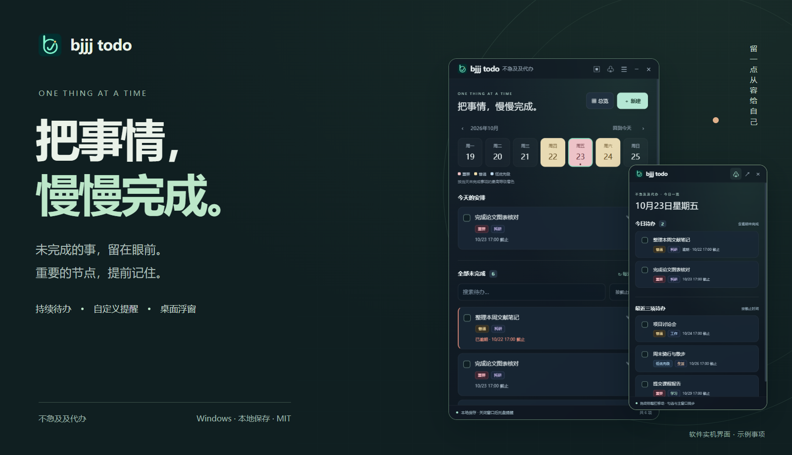
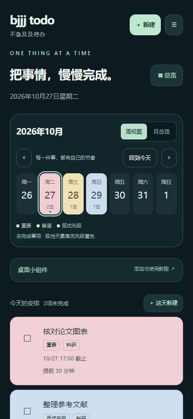
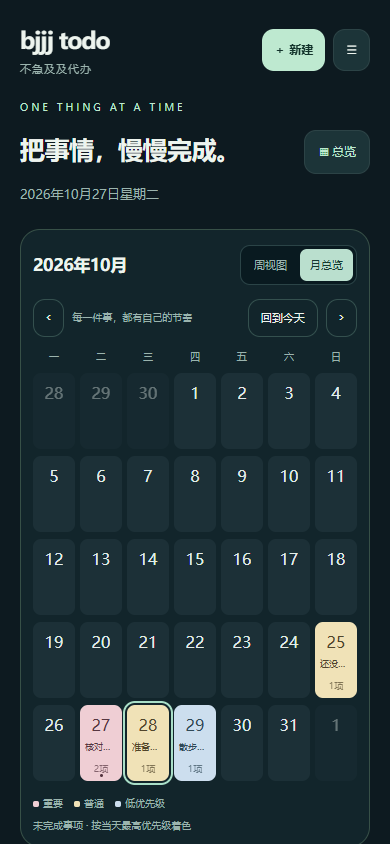
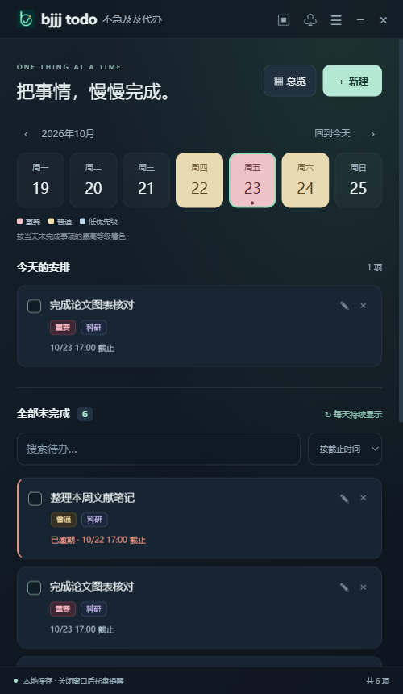
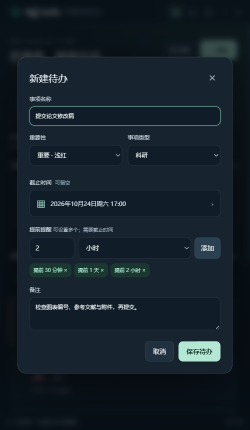
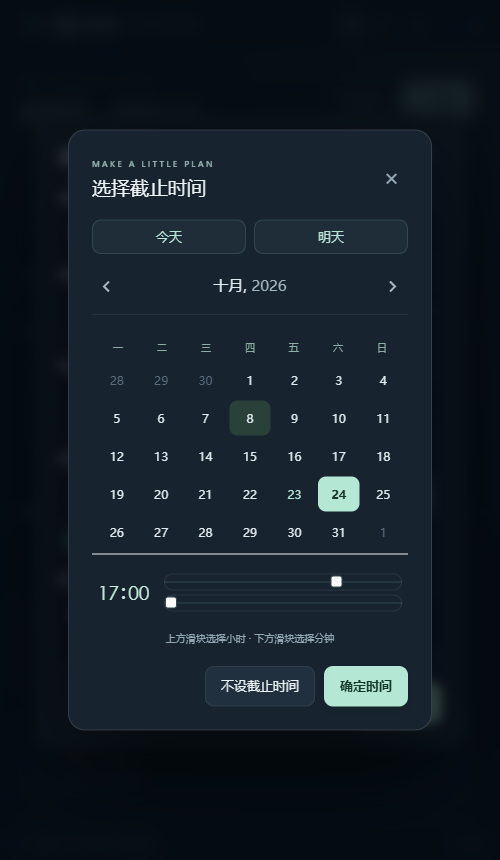
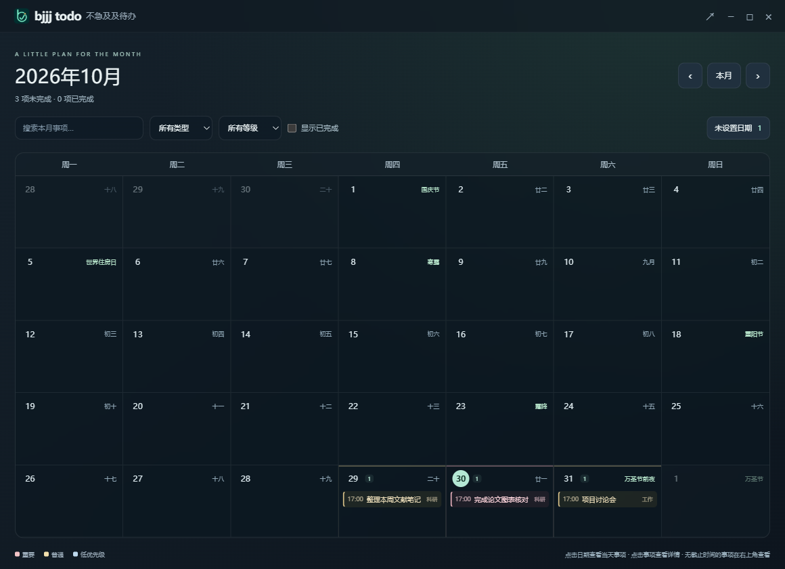
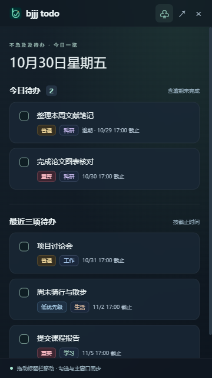
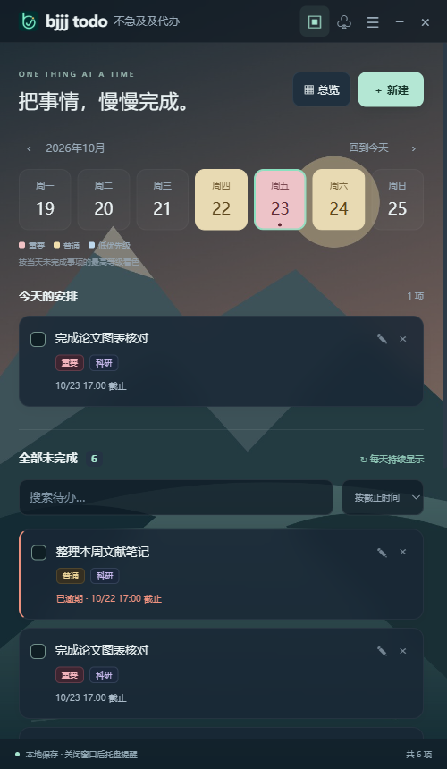

<a href="https://github.com/bjjjzmzbjf/bjjj-todo/releases/latest"></a>

<h1 align="center">不急及及代办 · bjjj todo</h1>

<p align="center"><b>未完成的事，留在眼前。重要的节点，提前记住。</b></p>
<p align="center">Windows 免安装 · Android 桌面组件 · 本地保存 · MIT 开源</p>
<p align="center"><a href="https://github.com/bjjjzmzbjf/bjjj-todo/releases/latest"><b>↓ 下载 Windows 版</b></a>　·　<a href="https://github.com/bjjjzmzbjf/bjjj-todo/releases/tag/v1.2.0"><b>↓ 下载 Android 版</b></a>　·　<a href="#从记录到完成">功能与截图</a>　·　<a href="#三步开始使用">开始使用</a>　·　<a href="https://github.com/bjjjzmzbjf/bjjj-todo/issues">反馈与建议</a></p>

论文还有几张图要改，明天的会议需要准备，周末也有自己的安排。事情写下来了，却可能随着翻页、切换日期，又被忘在一边。

**bjjj todo 是一个把待办留在桌面上的 Windows 小工具。** 今天先做什么、接下来要做什么、哪些事还没完成，都有清楚的位置。你可以设置适合自己的提醒节奏，也可以打开浮窗，让手头的事在工作时始终可见。

不用每天把昨天的待办重新抄一遍。记下来，然后一件件完成。

| 你想做的事 | bjjj todo 的方式 |
| --- | --- |
| 接着完成昨天没做完的事情 | “全部未完成”跨天持续保留，逾期也不会自动消失 |
| 为重要节点留出准备时间 | 同一事项可设置多个提前提醒，支持分钟、小时、天 |
| 工作时随手看一眼安排 | 桌面浮窗显示今日待办与最近三项，支持置顶和直接勾选 |
| 看清这个月的节奏 | 月历总览集中展示事项，支持类型、等级和关键词筛选 |

## Android：把待办铺到一页手机桌面

现已提供 **Android 1.2.0**（Android 8.0及以上）。原生桌面小组件支持“今日待办＋全部未完成”、滚动与分页、直接勾选完成，以及背景不透明度调整。App和组件的事项按重要性使用浅红、浅黄、浅蓝背景。App新增周日期条与月历总览：切换周/月、查看每日数量、按最高重要性给日期着色，选中日期查看安排或直接新建。两端统一采用新的账号卡片，支持登录／注册切换、密码显示和同步状态展示。App内可新建、编辑、分类，使用“数值＋天/小时/分钟/秒”添加多个提前提醒。

1. 从 [安卓版下载页](https://github.com/bjjjzmzbjf/bjjj-todo/releases/tag/v1.2.0) 下载 `bjjj.todo.android.apk` 并安装。
2. 打开App添加事项，点击“添加桌面小组件”；也可以长按桌面空白处 → 小组件 → 不急及及代办。
3. 把组件拖到一张空白桌面，长按组件并拉伸边框。实际大小及边距由手机桌面决定。

手机和电脑可选登录同一账号同步事项；安卓版现已支持周日期切换和月历总览，暂不提供导入导出。已在Android15模拟器验证，更多说明见 [安卓版使用指南](android/README.md)。

<p align="center"></p>

## 从记录，到完成

以下为Windows版软件实机截图，使用独立的示例事项；下载的程序不会附带这些数据。

### 01　没做完的事，明天仍然看得见

主窗口把**当天的安排**和**全部未完成**放在一起：前者帮助你安排今天，后者接住还没做完的事情。切换日期不会把未完成事项藏起来，过期事项也会继续保留，并标注逾期。

完成一项，勾选一项；需要继续处理时，也能从完成记录中恢复。事项多了，可以搜索关键词，或按截止时间、创建时间排序。

<p align="center"></p>

**让轻重缓急更直观。** 三个重要性等级分别使用浅红、浅黄、浅蓝；日期背景取当天未完成事项的最高等级。卡片同时显示类型标签，科研、工作、学习、生活和其他，共五类，保持简单。

| 重要性 | 日期颜色 | 适合怎样的安排 |
| --- | --- | --- |
| 重要 | 🟥 浅红 | 论文提交、重要汇报等需要优先关注的节点 |
| 普通 | 🟨 浅黄 | 会议准备、日常学习与工作安排 |
| 低优先级 | 🟦 浅蓝 | 整理资料、休闲计划等可以从容推进的事情 |

### 02　提醒时间，按你的准备节奏来

有些事情需要提前一天准备，有些只要提前半小时想起来就够了。新建事项时，可以为同一个截止时间添加**多个提醒节点**，自由填写分钟、小时或天数。

例如“提交论文修改稿”，可以同时设置：**提前 1 天 → 提前 2 小时 → 提前 30 分钟**。需要到点提示时，添加数值 `0` 即可。

<table>
  <tr>
    <td width="50%" align="center"></td>
    <td width="50%" align="center"></td>
  </tr>
  <tr>
    <td align="center"><sub>一个事项，可以有多个提前提醒</sub></td>
    <td align="center"><sub>中文日期面板，也能快捷选今天、明天</sub></td>
  </tr>
</table>

关闭主窗口后，软件仍会在托盘运行并检查提醒。电脑关机、休眠或程序完全退出期间无法弹出通知，恢复运行后会补发错过的提醒；Windows 勿扰设置可能影响通知横幅。

### 03　把一个月的安排，放到一张日历里

点击“总览”，就能从一条条待办切换到整月安排。哪些日期有事项、哪些节点更重要，可以一起查看；农历、节气和节日标签也会显示在月历中。



- **按你关心的内容查看**：筛选科研、工作等类型，筛选重要性，或搜索关键词。
- **从日期直接处理事项**：点击日期展开当天安排，查看详情、勾选完成，或新建该日事项。
- **和其他窗口保持同步**：在主窗口、总览或浮窗中编辑和完成，其他窗口会同步更新。
- **没排日期的想法也有位置**：在“未设置日期”中查看，不必为了记一件事先确定截止时间。

同一天事项较多时，可以展开完整列表；勾选“显示已完成”还能回看完成记录。日历中的节日和节气是日期标签，不表示法定放假或调休安排。

### 04　让接下来要做的事，留在桌面一角

写文章、读文献、开会时，打开一个独立浮窗，把安排放在视线范围内。浮窗可以拖动、调整大小、独立置顶，也能直接勾选完成。

<table>
  <tr>
    <td width="46%" align="center"></td>
    <td width="54%">
      <p><b>今日待办</b></p>
      <p>显示今天截止的事项，也保留之前逾期未完成的事项。</p>
      <br>
      <p><b>最近三项</b></p>
      <p>按截止时间展示接下来的三项，不重复显示今日区已有的事项；未设时间的事项排在最后。</p>
      <br>
      <p><b>随手完成，窗口同步</b></p>
      <p>在浮窗中勾选后，主窗口和月历会一起更新。重启后恢复浮窗的开关与位置。</p>
    </td>
  </tr>
</table>

### 05　换一张背景，让桌面更像自己的空间

在设置中选择本地图片，就能更换软件背景，并调整遮罩深浅。主窗口、月历和浮窗同步使用同一张背景，也可以随时恢复默认外观。

<p align="center"></p>
<p align="center"><sub>示例山景背景 · 可替换为自己的图片</sub></p>

支持 PNG、JPEG、WebP，单张图片最大 20 MB。背景会复制到本机数据目录。

### 06　事项存在本机，备份也能自己掌握

日常使用不需要注册账号，事项和设置保存在本机文件中。设置里可以导出 JSON 备份，也可以导入已有备份；软件会自动保留上一份保存的数据。

默认位置：`%APPDATA%\bjjj todo\`

| 文件 | 保存内容 |
| --- | --- |
| `tasks.json` | 待办事项、提醒节点与软件设置 |
| `tasks.json.bak` | 上一份保存的数据 |
| `background.jpg` | 选择的背景图片 |

JSON 导入会**追加**事项，重复导入可能产生重复记录；JSON 备份不包含背景图片。更新软件前，建议先导出一份备份。

## 这些场景，可以这样用

| 场景 | 一个具体用法 |
| --- | --- |
| 科研与论文 | 把修改稿、图表核对、组会准备归为“科研”，重要提交节点设置多次提前提醒 |
| 工作与协作 | 会议和交付节点放进月历，桌面浮窗保留今天要做的事情 |
| 学习与课程 | 记录阅读任务、作业截止和报告提交，按日期逐项推进 |
| 生活与个人安排 | 购物、运动、出行准备和临时想法也能放进来，暂时没有日期的事先记下 |

## 可选：电脑与手机云同步

升级到1.2.0，在两端设置中登录同一个同步账号，即可合并并同步事项。支持离线修改后补同步，冲突时保留修改副本。背景和窗口等设备设置分别保留。当前内置服务用于个人测试，完整注册说明、后台同步时机与自建方式见 [云同步指南](CLOUD_SYNC.md)。

## 三步开始使用

**当前版本：v1.2.0。** 新增手机周视图与月历总览，统一优化两端账号登录界面。 已在 Windows 11 x64 环境验证。

1. **下载程序**：打开 [Releases 下载页](https://github.com/bjjjzmzbjf/bjjj-todo/releases/latest)，下载 Assets 下的 **`bjjj.todo.exe`**。这是免安装单文件程序；GitHub 自动生成的 `Source code` 压缩包是源码。
2. **放好再运行**：把程序放在固定目录，双击打开。首次运行会自动创建“不急及及代办”桌面快捷方式；也可以在设置中补建。
3. **记下第一件事**：点击“＋ 新建”，填写事项，选择类型与重要性；需要提醒时，设置截止时间，添加提醒节点，再保存。

之后可以按需要开启桌面浮窗、窗口置顶或开机启动，也可以换一张自己的背景图。

当前程序尚无数字签名；下载页同时提供 `SHA256SUMS.txt` 校验文件。目前未提供 macOS、Linux 或 Windows ARM 专用版本。

## 常见问题

<details>
<summary><b>关闭窗口后，还会提醒吗？怎样彻底退出？</b></summary>

会。关闭主窗口默认隐藏到 Windows 托盘，程序继续运行。需要彻底退出时，右键托盘图标，选择“退出软件”；也可以在设置中退出。彻底退出期间不会弹出通知。

</details>

<details>
<summary><b>桌面快捷方式没了，或移动程序后打不开，怎么办？</b></summary>

从程序的新位置打开软件，在设置中点击“创建桌面快捷方式”即可补建。请将免安装程序放在固定目录；只删除快捷方式不会删除待办数据。

</details>

<details>
<summary><b>为什么没有收到系统通知？</b></summary>

请确认事项已保存截止时间和提醒节点，软件没有完全退出，且 Windows 没有屏蔽通知。可以在设置中点击“测试系统通知”。电脑关机、休眠或程序退出期间无法实时提示，恢复运行后会补发错过的提醒。

</details>

<details>
<summary><b>支持云同步、多设备同步或手机端吗？</b></summary>

现已提供Android版，下载及使用方法见上方Android介绍。两端现已支持可选账号与同步，仍各自保留本地数据。使用方法见 [云同步指南](CLOUD_SYNC.md)。Windows版支持JSON导入导出，安卓版暂不支持手动数据迁移。

</details>

## 开源与参与

这是 bjjj todo 的第一个公开版本。如果它让你的日常安排更轻松，欢迎在右上角点一个 **Star ⭐**，也欢迎分享给需要的朋友，让更多人发现它。

你也可以通过 [Issues](https://github.com/bjjjzmzbjf/bjjj-todo/issues) 反馈问题和提出功能建议，或提交 Pull Request。反馈时请写明软件版本、Windows 版本和复现步骤；截图中请先隐藏个人事项。参与方式见 [贡献说明](CONTRIBUTING.md)。

<details>
<summary><b>本地开发与检查</b></summary>

使用 Node.js 24，在 Windows 中运行：

```sh
git clone https://github.com/bjjjzmzbjf/bjjj-todo.git
cd bjjj-todo
npm ci
npm start
```

运行 `npm test` 执行逻辑检查，`npm run build` 生成 Windows 免安装程序，输出位于 `release/`。

需要检查打包后的窗口协同与快捷方式时：

```sh
npx electron-builder --win --x64 --dir
node overview-smoke.cjs
node names-smoke.cjs
node shortcut-smoke.cjs
```

生成下载校验文件：`node scripts/release-checksum.cjs`。更多操作细节见 [使用指南](USAGE.md)。

</details>

本项目采用 [MIT 许可](LICENSE)，允许使用、修改和分发，请保留版权及许可声明。日期面板使用 [Air Datepicker](https://github.com/t1m0n/air-datepicker)，农历标签使用 [lunar-javascript](https://github.com/6tail/lunar-javascript)；Electron / Chromium 运行时的许可随程序分发。详见 [第三方许可](THIRD-PARTY-NOTICES.txt)。

<p align="center"><b>把事情，慢慢完成。</b><br><sub>不急及及代办 · bjjj todo</sub></p>
